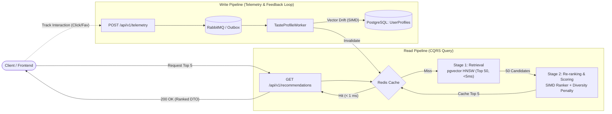

# Vector Recommendation Engine

High-performance, real-time personalized recommendation engine built on .NET, PostgreSQL with pgvector, Redis, and RabbitMQ. The system implements a two-stage recommendation funnel (Retrieval and Re-ranking) combined with an asynchronous feedback loop that dynamically shifts user taste profiles in vector space using SIMD operations.

---

## Architecture & System Design

The architecture decouples query and command workloads using CQRS. Reads are optimized for low-latency retrieval and caching, while writes (telemetry and user interactions) are processed asynchronously in the background.



---

## Core Algorithmic Concepts

### 1. Two-Stage Recommendation Funnel

1. **Stage 1 — Candidate Retrieval (ANN Search)**
   - Database: PostgreSQL with the `pgvector` extension.
   - Index: Hierarchical Navigable Small World (`HNSW`) with `vector_cosine_ops` (`m = 16`, `ef_construction = 64`).
   - Query: Efficiently prunes catalog vectors to return the top 50 nearest candidates based on cosine distance (`<=>`) in 2–5 ms.

2. **Stage 2 — In-Memory Re-ranking & Diversity Scoring**
   - Scoring Formula:
     `FinalScore = (0.7 * CosineSimilarity) + (0.3 * NormalizedPopularity) - DiversityPenalty`
   - **Logarithmic Popularity**: Popularity scores are normalized using a logarithmic scale (`MathF.Log(1 + score) / logMax`) to prevent viral items from overshadowing relevance.
   - **Diversity Penalty**: Applies a progressive penalty (`categoryPenaltyStep = 0.15`) for each item selected from the same category to combat filter bubbles and over-specialization.

### 2. Real-Time Feedback Loop & Taste Drift

- Every user action (`Click`, `Favorite`, `Booked`, `IgnoredRepeatedly`) triggers a telemetry event.
- Background worker calculates vector displacement using `System.Numerics.Tensors.TensorPrimitives`:
  - `NewTaste = Normalize(CurrentTaste + alpha * ItemEmbedding)`
  - Learning rate (`alpha`) is dictated by `InteractionWeightPolicy`:
    - `IgnoredRepeatedly`: -0.05
    - `Click`: +0.10
    - `Favorite`: +0.25
    - `Booked`: +0.40
- The updated taste vector is persisted in PostgreSQL, and the user's recommendation cache in Redis is invalidated.

### 3. Cold-Start Strategy

When a user has no prior interaction history (`UserTasteProfile` is null):
- System retrieves globally trending items tracked via Redis `SortedSet` (`ZINCRBY` / `ZREVRANGE`).
- If Redis popularity data is unavailable, it falls back to database catalog popularity scores.

---

## Technology Stack

- **Runtime & Language**: .NET (C#)
- **Database & Vectors**: PostgreSQL 17 + `pgvector` (HNSW indexing, cosine similarity)
- **In-Memory & Caching**: Redis 7 (distributed result cache, real-time sorted sets for popularity)
- **Message Broker**: RabbitMQ 4 (channel-based push consumer, dead-letter exchange/queue support)
- **Resilience**: Transactional Outbox pattern fallback when message broker is unreachable
- **Vector Acceleration**: Hardware-accelerated SIMD with `TensorPrimitives`
- **Architecture**: CQRS (MediatR), Clean Architecture, ASP.NET Core Minimal APIs, API Versioning

---

## Project Structure

```text
├── src/
│   ├── RecSys.Domain/              # Pure domain entities, enums, and interaction policies
│   │   ├── Entities/               # CatalogItem, UserTasteProfile, OutboxMessage, User
│   │   ├── Enums/                  # InteractionType, ItemCategory
│   │   └── Rules/                  # InteractionWeightPolicy
│   │
│   ├── RecSys.Application/         # CQRS queries, commands, math algorithms, and interfaces
│   │   ├── Abstractions/           # Service ports (cache, queue, vector math, ranker)
│   │   ├── CQRS/                   # Handlers for recommendations and telemetry
│   │   └── Services/               # SIMD VectorMathService, RecommendationRanker
│   │
│   ├── RecSys.Infrastructure/      # Database migrations, Redis cache, RabbitMQ worker
│   │   ├── BackgroundJobs/         # TasteProfileWorker (RabbitMQ consumer)
│   │   ├── Caching/                # RedisRecommendationCacheService
│   │   ├── Messaging/              # RabbitMqInteractionEventQueue
│   │   └── Persistence/            # EF Core AppDbContext, Dapper providers, pgvector configs
│   │
│   └── RecSys.Api/                 # ASP.NET Core Minimal API endpoints & configuration
│       ├── Endpoints/              # RecommendationEndpoints, TelemetryEndpoints
│       └── RecSys.Api.http         # Executable HTTP request specifications
│
├── tests/
│   └── RecSys.Application.Tests/   # Unit tests covering ranking, diversity, and vector math
│
├── docker-compose.yml              # PostgreSQL with pgvector, Redis, and RabbitMQ
└── seed.sql                        # Normalized 3D catalog dataset for testing
```

---

## Getting Started

### Prerequisites

- .NET SDK (matching project specification)
- Docker & Docker Compose

### 1. Start Infrastructure Services

Run PostgreSQL, Redis, and RabbitMQ containers:

```bash
docker compose up -d
```

### 2. Database Migration & Seeding

Migrations and sample catalog data are automatically applied on application startup via `Program.cs`. Sample vectors can also be reviewed in `seed.sql`.

### 3. Run the API

```bash
dotnet run --project src/RecSys.Api
```

The service will start listening on `http://localhost:5093`.

---

## API Reference

### 1. Recommendations

**Get Recommendations for User**
```http
GET /api/v1/recommendations/{userId}?topK=5
Accept: application/json
```

**Response (200 OK):**
```json
{
  "userId": "u_0192a000-0001-7000-8000-000000000001",
  "items": [
    {
      "id": "eci_0192a001-0001-7000-8000-000000000001",
      "title": "MacBook Pro M3 Max 16\"",
      "category": 0,
      "finalScore": 0.892,
      "cosineSimilarity": 0.941,
      "normalizedPopularity": 0.780,
      "diversityPenalty": 0.0
    }
  ],
  "source": 2,
  "executionTimeMs": 3.42
}
```
*`source`: 1 = `RedisCache`, 2 = `PgVectorHnsw`, 3 = `ColdStart`.*

### 2. Telemetry

**Track Interaction**
```http
POST /api/v1/telemetry/interaction
Content-Type: application/json
X-Correlation-Id: 0192a005-4f32-731a-9821-41913cbb8a21

{
  "userId": "u_0192a000-0001-7000-8000-000000000001",
  "itemId": "eci_0192a001-0001-7000-8000-000000000001",
  "interactionType": 1
}
```
*`interactionType`: -1 = `IgnoredRepeatedly`, 1 = `Click`, 2 = `Favorite`, 3 = `Booked`.*

**Response:** `202 Accepted`

---

## Testing

Run unit tests via CLI:

```bash
dotnet test
```
